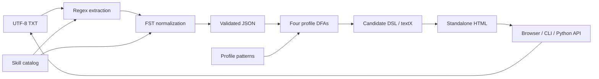

# Design and test scenarios

The same four-stage pipeline serves the Python API, CLI and local browser UI.
Regex extracts original evidence; FSTs normalize aliases; four complete DFAs
recognize profiles; textX validates the candidate language before HTML rendering.

## Modules and functions

| Module / functions | Input | Output and responsibility |
|---|---|---|
| `catalog.load_catalog`, `validate_catalog` | Packaged catalog / dictionary | Configuration; rejects duplicate casefolded aliases |
| `extraction.skill_pattern`, `extract_resume` | Catalog, original text, optional name | Compiled regex; candidate data, positive/excluded evidence and warnings |
| `normalization.build_transducers`, `normalize_skills` | Catalog / extracted evidence | Four category FSTs; canonical skills, evidence links and untranslated inputs |
| `first_stage.process_resume`, `validate_result` | Original text / result and text | JSON 1.0; checks schema, exact spans, indices and FST translations |
| `classification.load_profiles`, `validate_profile`, `profile_buckets` | Profile configuration | Validated patterns and disjoint, ordered symbol buckets |
| `classification.build_profile_automaton`, `canonical_sequence`, `classify_skills` | Profile / canonical skills | Complete DFA, ordered relevant sequence, four decisions and explanations |
| `dsl.generate_candidate_dsl`, `parse_candidate_dsl` | First-stage/classification data / DSL source | Specification / parsed candidate; checks syntax, duplicates and exact accepted profiles |
| `rendering.render_candidate_html` | Candidate DSL | Escaped standalone HTML after textX validation |
| `workflow.process_complete_resume`, `save_bundle` | Text and optional name / complete result and destination | All stage results / four validated UTF-8 files with overwrite and recovery checks |
| `cli.main`, `workflow_cli.main` | Command-line arguments | JSON or bundle; exit 0 on success, 2 on invalid input/export |
| `web.process_web_request`, `create_server`, `main` | JSON request / local port and options | Complete result, downloads and ZIP / loopback server |
| `ui/app.js` | File bytes, pasted text, actions and HTTP response | Current report, evidence, decisions, downloads and accessible feedback |
| `tools/evaluate_preannotated.py`, `tools/evaluate_workflow.py` | Frozen inputs, annotations and protocol | Separate case-level JSON/Markdown reports; `--check` verifies without writing |

Packaged catalog, profile configuration and schema copies must match `config/`
and `contracts/`. Tests detect divergence. Changing canonical symbols requires
updating the catalog, schema, profiles, generated models and fixtures together.

## Decisions and limits

- Evidence is `{raw, start, end}` in Python characters, with an inclusive start
  and exclusive end: `text[start:end] == raw`. Decoding accepts a UTF-8 BOM and
  preserves original line endings. The input is never casefolded in place.
- Candidate names are strings or null; explicit input names take precedence over
  fallback names. Contacts, education and experience retain evidence lists.
  A section line is one record; employers, institutions and total duration are not inferred.
- Longer skill aliases precede shorter ones. Actual `FST.translate` calls consume
  a complete casefolded alias and emit one canonical symbol. PostgreSQL does not
  imply SQL; PySpark does not imply Apache Spark.
- First-stage symbols are unique and alphabetical. Each DFA receives a separate
  canonical bucket sequence retaining all relevant skills. Backend states retain
  language/framework compatibility. A total transition function and rejecting
  sink handle invalid sequences. Profiles may overlap.
- Profile explanations follow the actual automaton decision and configured
  alternatives. They add no inferred skills. HTML recomputes them from parsed DSL
  skills; export rejects tampered or inconsistent results.
- The DSL uses JSON-style strings, fixed section order and repeated records.
  Semantic checks reject duplicate skills/profiles, unknown symbols and incorrect
  accepted-profile declarations. Candidate text is escaped in HTML.
- The local HTTP adapter serves packaged assets on loopback, serializes processing
  around cached models/parser and retains no candidate history. The UI discards
  stale results after edits and preserves unedited file bytes for span fidelity.
- Supported context and bounded negation are documented in
  [regex](regex.md) and [negation handling](negation-handling.md). Unknown
  technologies, double negation and some attribution/context wording remain limitations.

Full formal models are in [transducers](transducers.md),
[profile recognition](profile-recognition.md) and [candidate language](candidate-language.md).
The [JSON contract](data-contract.md) defines the first-stage boundary.

## Test scenarios

Automated cases are in `tests/`. Run them and the acceptance checks using the
[README commands](../README.md#verification). These scenarios cover the required
normal paths, alternatives, rejected inputs and integration boundaries.

| Component | Scenarios | Expected result |
|---|---|---|
| Candidate data | Explicit/absent/fallback name; repeated contacts; education/experience sections; Unicode | Correct values and original spans; no arbitrary name or record inference |
| Regex | All 56 aliases and capitalization variants; JavaScript/GitHub boundaries; dotted aliases | Exact complete mentions; no subword matches |
| Context/negation | JS/TS lists, React technical predicates, Pandas technical/animal usage; coordinated negative lists, contrast and later positives | Supported positives normalize; exclusions retain reasons and exact spans |
| FSTs | Every alias; unknown strings, prefixes/suffixes and conflicting catalog entries | Exactly one admitted canonical output; unknown/conflicting inputs rejected |
| JSON contract | Changed schema fields, offsets, indices and translations; repeated aliases | Corruption rejected; unique symbols retain all evidence links |
| CLI input/output | BOM, LF/CRLF, nested folders, existing output, hard-link input aliases, different working directory | API agreement, input preserved, overwrite guarded and exit 0/2 |
| DFA patterns | Every required-group alternative; missing groups; extra/reordered/repeated skills; empty input | Actual automaton accepts only configured patterns; public decisions remain stable |
| Backend compatibility | All single pairs and multiple languages/frameworks; missing language/framework/database | Only a compatible pair with other groups accepts; specific missing alternatives explained |
| Assignment alignment | Twelve minimal ML reference paths; Scikit-learn aliases; model-only/negated-library inputs | Admitted library alternatives accept; optional or negated skills do not replace requirements |
| Complete models | Total transition tables, reconstructed exports, canonical preparation | Exports equal executable models; exactly one next state per state/symbol |
| DSL syntax | Required/reordered/missing sections, empty/repeated records, escapes, trailing text, unknown tokens | Valid documents round-trip; malformed documents rejected |
| DSL semantics/HTML | Duplicate skills/profiles, omitted/invented profiles, hostile candidate strings | Invalid claims block rendering; valid text remains escaped |
| Workflow fixtures | Eight samples, incomplete and simultaneous profiles, invalid DSL fixtures | Stored four-file bundles agree with actual processing; deliberate invalid fixtures reject |
| Export recovery | Partial preparation, each replacement failure, original-file presence combinations, competing exporters, failed rollback | Prior files restored on controlled failure; unrelated files preserved; backups retained when recovery fails |
| HTTP | Eight inputs and concurrent candidates; invalid JSON/types/encoding/size; rejected routes, Host/Origin and delayed bodies | Shared API results; clean English errors; no processing or file exposure on rejection |
| Downloads | Individual files, in-memory ZIP and saved CLI bundle | Exactly four UTF-8 members with equal bytes |
| Browser | Upload/example/process/edit/clear; keyboard focus, busy states, failed requests, narrow layout, reduced motion/high contrast | Current input/result only; usable navigation, matching downloads and recoverable feedback |
| Evaluation protocols | Tampered inputs/labels, changed runtime, repeated spans, scoring and report checks | Freeze preserved; exact units scored; differences and pipeline errors retained |

The optional browser runner exercises 18 real interaction groups separately from
Python unit tests. Frozen evaluation cases remain separate from these tests;
[verification results](test-results.md) distinguish executed checks from dataset metrics.
