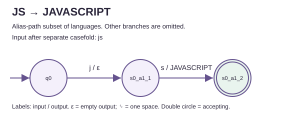
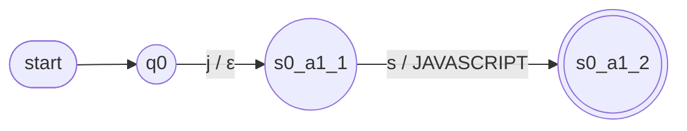
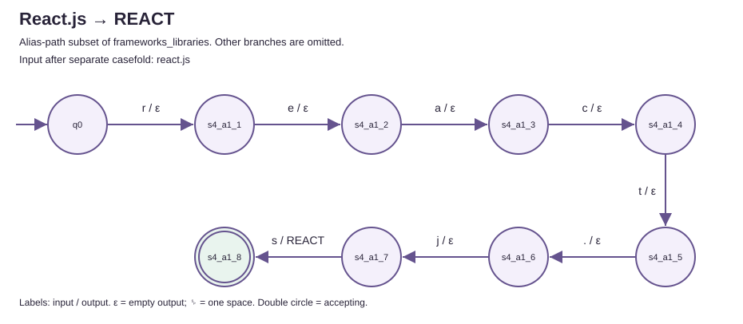
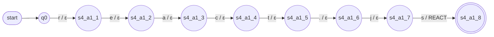
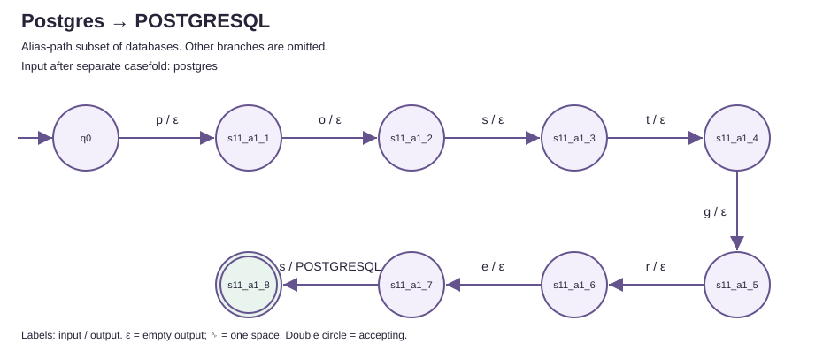
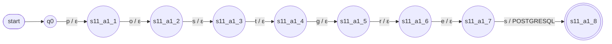
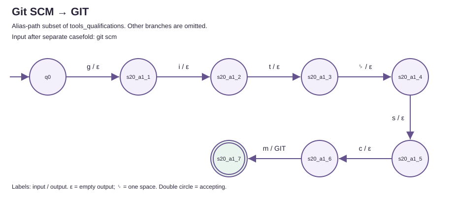
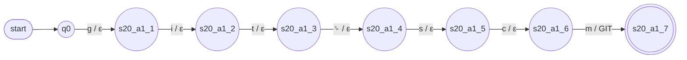

# Worked transducer paths

These views show four accepting alias paths taken from the executable
`pyformlang.fst.FST` machines. They retain the real state names and transition
labels. Each is a **subset of a complete category machine**: omitted branches
still exist, and the full machine remains nondeterministic. These are neither
separate production transducers nor minimized replacements.

The input to each FST is `list(raw.casefold())`. Case folding is a separate
preprocessor; it does not collapse separators or internal spaces. In the
labels and tables, `␠` means exactly one space and `ε` means empty **output**.
Every edge consumes its displayed input character. The initial arrow marks
`q0`; a double circle marks an accepting state.

[Complete seven-tuples and full diagrams](../../transducers.md)

Regenerate from an installed checkout with:

```powershell
.\.venv\Scripts\python.exe tools/export_model_examples.py
.\.venv\Scripts\python.exe tools/export_model_examples.py --check
```

The generator verifies each edge, complete input consumption, accepting
state and canonical output against the actual machine before writing. Check
mode also rejects stored views that differ from those verified transitions.

## JS → JAVASCRIPT

Category: `languages`. Raw input: `JS`. FST input: `js`.





| Step | Raw character | FST input | Source | Target | Output |
|---:|---|---|---|---|---|
| 1 | `J` | `j` | `q0` | `s0_a1_1` | `ε` |
| 2 | `S` | `s` | `s0_a1_1` | `s0_a1_2` | `JAVASCRIPT` |

The complete input is exhausted at `s0_a1_2`; concatenating the
transition outputs produces the single symbol `JAVASCRIPT`.

## React.js → REACT

Category: `frameworks_libraries`. Raw input: `React.js`. FST input: `react.js`.





| Step | Raw character | FST input | Source | Target | Output |
|---:|---|---|---|---|---|
| 1 | `R` | `r` | `q0` | `s4_a1_1` | `ε` |
| 2 | `e` | `e` | `s4_a1_1` | `s4_a1_2` | `ε` |
| 3 | `a` | `a` | `s4_a1_2` | `s4_a1_3` | `ε` |
| 4 | `c` | `c` | `s4_a1_3` | `s4_a1_4` | `ε` |
| 5 | `t` | `t` | `s4_a1_4` | `s4_a1_5` | `ε` |
| 6 | `.` | `.` | `s4_a1_5` | `s4_a1_6` | `ε` |
| 7 | `j` | `j` | `s4_a1_6` | `s4_a1_7` | `ε` |
| 8 | `s` | `s` | `s4_a1_7` | `s4_a1_8` | `REACT` |

The complete input is exhausted at `s4_a1_8`; concatenating the
transition outputs produces the single symbol `REACT`.

## Postgres → POSTGRESQL

Category: `databases`. Raw input: `Postgres`. FST input: `postgres`.





| Step | Raw character | FST input | Source | Target | Output |
|---:|---|---|---|---|---|
| 1 | `P` | `p` | `q0` | `s11_a1_1` | `ε` |
| 2 | `o` | `o` | `s11_a1_1` | `s11_a1_2` | `ε` |
| 3 | `s` | `s` | `s11_a1_2` | `s11_a1_3` | `ε` |
| 4 | `t` | `t` | `s11_a1_3` | `s11_a1_4` | `ε` |
| 5 | `g` | `g` | `s11_a1_4` | `s11_a1_5` | `ε` |
| 6 | `r` | `r` | `s11_a1_5` | `s11_a1_6` | `ε` |
| 7 | `e` | `e` | `s11_a1_6` | `s11_a1_7` | `ε` |
| 8 | `s` | `s` | `s11_a1_7` | `s11_a1_8` | `POSTGRESQL` |

The complete input is exhausted at `s11_a1_8`; concatenating the
transition outputs produces the single symbol `POSTGRESQL`.

## Git SCM → GIT

Category: `tools_qualifications`. Raw input: `Git SCM`. FST input: `git scm`.





| Step | Raw character | FST input | Source | Target | Output |
|---:|---|---|---|---|---|
| 1 | `G` | `g` | `q0` | `s20_a1_1` | `ε` |
| 2 | `i` | `i` | `s20_a1_1` | `s20_a1_2` | `ε` |
| 3 | `t` | `t` | `s20_a1_2` | `s20_a1_3` | `ε` |
| 4 | `␠` | `␠` | `s20_a1_3` | `s20_a1_4` | `ε` |
| 5 | `S` | `s` | `s20_a1_4` | `s20_a1_5` | `ε` |
| 6 | `C` | `c` | `s20_a1_5` | `s20_a1_6` | `ε` |
| 7 | `M` | `m` | `s20_a1_6` | `s20_a1_7` | `GIT` |

The complete input is exhausted at `s20_a1_7`; concatenating the
transition outputs produces the single symbol `GIT`.

## Boundary examples

Direct FST translation rejects `JSx`, `ReactXjs`, `React-js`, `Git  SCM` and
`Postgres extra`: none is a complete catalog alias. `React.js` keeps its
literal dot, and `Git SCM` consumes exactly one internal space. An extractor
may locate a shorter alias within a larger source string; that is a separate
stage and does not expand the language accepted by the FST.
